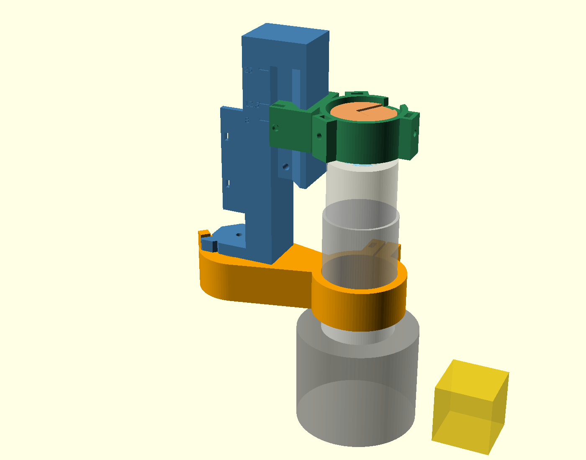
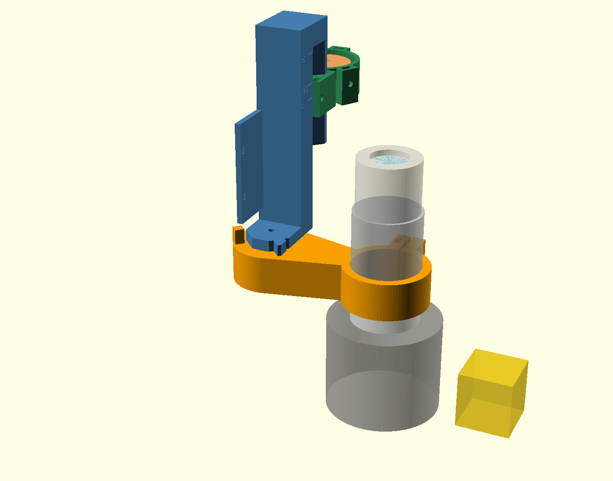
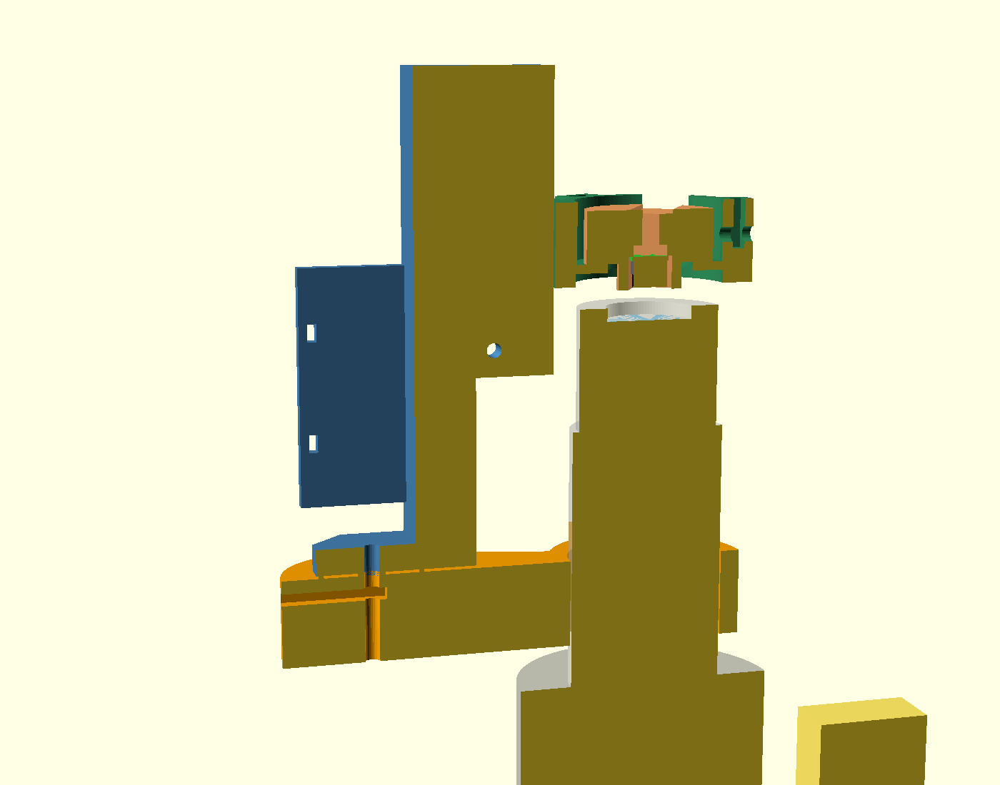

# Camera arm (OV5640 behind the eyepiece, swing-away)

Parametric OpenSCAD model: `camera_arm.scad`. Option 2 next to the [camera cap](../camera-cap/README.md):
the camera is not carried by the eyepiece but by an arm that hangs on a collar around the Barlow. The
arm swings 90 degrees to the side so you can look through the eyepiece, and swings back onto a hard
stop. The camera, the arm and the ESP32-S3 CAM board are the same for all three eyepieces; only the
camera height changes (a sliding dovetail with engraved marks).

Four printed parts plus hardware:

- **collar**: split ring clamping the Barlow body (M3 pinch screw), with a long tab that carries the
  vertical hinge: M3 axle with a captive nut, two magnet pockets (0 and 90 degrees) and the printed
  hard stop for 0 degrees.
- **arm**: foot plate on the hinge, upright post, horizontal boom at the top, and a vertical dovetail
  **rail** hanging from the boom end. The ESP32-S3 CAM board bolts to a plate on the post with zip
  ties. Z marks for 25 / 12.5 / 8 mm are engraved on the post.
- **cup**: rides on the rail (dovetail groove, M3 lock thumbscrew). Three nylon M3 thumbscrews centre
  the carrier by about +-2 mm in x and y. A short skirt shields the gap towards the eyepiece.
- **carrier**: puck floating in the cup. Holds the OV5640 module lens down on the optical axis, with the
  FPC slot and groove (same module pocket as the camera cap head).

The previews show the 12.5 mm eyepiece. The grey cylinder under the collar is a stand-in for the
focuser and the yellow box for the focus motor; the hinge sits on the opposite side
(`motor_angle + 180`, in the preview the hinge is at the left).

Assumptions to check: the defaults describe a National Geographic 76/700 Newtonian with its 1.25 inch
focuser, the 25 / 12.5 / 8 mm eyepieces always used in the 3x Barlow, and a focus motor on the focuser
(GT2 belt to the knob). The heights and eye relief values are **estimates**; measure them.

## Camera arm or camera cap?

| | camera cap | camera arm |
|---|---|---|
| Eyepiece | one cap per eyepiece, camera head moved between caps | nothing on the eyepiece; one arm for all |
| Looking through it | pull the cap off | swing the arm aside (one hand, magnet detent) |
| Stiffness | very stiff (short, on the eyepiece housing) | less stiff: a 110 mm tall arm, about 65 mm of lever to the camera |
| Centring | 3 thumbscrews per cap | once per session at the cup, 3 thumbscrews; arm repeats within the hinge play |
| Height | few mm, set once per cap | 28 mm of travel, marks per eyepiece |
| Light shield | closed tube on the rim (best) | short skirt only; add black foam (see assembly) |
| Eyepiece swap | swap cap and head | slide the cup to the next mark, re-centre |
| Parts to print | 3 caps + 1 head | collar, arm, cup, carrier |
| Risk | adds weight and length on the focuser | needs the hinge tab clear of the focuser and the motor |

Use the cap when you stay on one eyepiece and want the simplest, stiffest and darkest setup. Use the arm
when you swap eyepieces during a session and want to switch between looking and imaging quickly.

## Parts you need

- collar: 1x M3 x 20 thumb or cap screw + 1x M3 nut (pinch); 1x M3 x 16 screw (hinge axle, or M4,
  `hinge_bolt = 4`) + 1x nut (nyloc preferred) + 1x washer; 3x neodymium disc magnets 6 x 3 mm
  (`magnet_d`, `magnet_t`)
- arm: 1x M3 x 16 screw + 1x M3 nut (travel stop bolt through the rail)
- cup: 1x M3 x 12 thumbscrew + 1x M3 nut (Z lock); 3x nylon M3 x 16 thumbscrews + 3x M3 nut (centring)
- carrier: 2x M2 x 4 grub screws (or `retain = false` and a dab of hot glue)
- zip ties 2 mm thick x 4 mm wide, black foam or flocking paper, black PETG, CA glue for the magnets

## What to measure

Use calipers. Edit the values at the top of `camera_arm.scad`, or override on the command line, for
example `-D barlow_od=35.6`.

1. **barlow_od**: outer diameter of the Barlow body where the collar clamps (default 36). Measure at
   three places along the clamp zone and use the largest. The collar bore is `barlow_od + 0.6`.
2. **barlow_above_collar**: height of the Barlow top edge above the collar's top face (default 30).
   Decide where the collar sits first (above the focuser, clear of the focuser top and the thumbscrews,
   `collar_h` = 20 mm tall), then measure from the collar's top plane up to the Barlow's top edge. The
   whole Z scale hangs on this number.
3. **eyepiece height above the Barlow** (last column of `eyepiece_table`: 35 / 28 / 24): with the
   eyepiece seated in the Barlow as you use it, measure from the Barlow's top edge up to the
   eyepiece housing rim, per eyepiece.
4. **rim recess** (4th column, default 3): lay a straight edge across the rim and measure down to the
   eye lens glass with the depth rod.
5. **eye relief with the Barlow** (3rd column: 18 / 9 / 5), by the paper method:
   1. Put the Barlow and the eyepiece in the focuser as you normally use them.
   2. Point the telescope at a bright, distant daylight scene (a window with sky, a far bright wall).
      **Never point it at the Sun, not even briefly: the telescope focuses sunlight into a burn
      spot and a blinding beam.** Cover the Sun's direction and keep the telescope far from it.
   3. Hold white paper behind the eyepiece and move it away from the eye lens until the bright disc
      is smallest and sharpest. That disc is the exit pupil.
   4. Measure from the eye lens glass (not the rim) to the paper. Repeat three times, use the mean.
6. **housing OD** (2nd column, default 33) and **rim_id** (default 20, opening at the rim).
7. **OV5640 module**: PCB width and thickness, lens holder width, lens front to PCB front face
   (`module_h`), FPC width. Same block as in `camera_cap.scad`.
8. **ESP32-S3 CAM board**: `esp_w` x `esp_l` (default 27 x 50).
9. The **focus motor side**: set `motor_angle` (angle seen from above, 0 = +x) to where the motor and
   belt are. The hinge goes opposite. Check the swing sweeps clear of the motor, the belt and the
   focus knob. `hinge_pos` sets where the pinch ear sits relative to the hinge around the collar.

## The height formula

For each eyepiece row:

    rim_z   = barlow_above_collar + eyepiece_above_barlow           (over the collar top)
    gap     = eye_relief - rim_recess - lens_stop_offset            (as in camera_cap)
    lens_z  = rim_z + gap                                           (lens front glass, the mark)

| eyepiece | above Barlow | eye relief | recess | stop offset | gap | rim z | lens z (mark) | engraved line (cup block top) |
|---|---:|---:|---:|---:|---:|---:|---:|---:|
| 25 mm   | 35 | 18 | 3 | 1.5 | 13.5 | 65 | 78.5 | 98.0 |
| 12.5 mm | 28 |  9 | 3 | 1.5 |  4.5 | 58 | 62.5 | 82.0 |
| 8 mm    | 24 |  5 | 3 | 1.5 |  0.5 | 54 | 54.5 | 74.0 |

The cup travels from `c_min = lowest lens z - z_margin` to `c_max = highest lens z + z_margin`
(`z_margin` = 2): 52.5 to 80.5 mm, **28 mm of travel** with the defaults. The model asserts at least
25 mm, that the nose cannot touch the eye lens at the low end and, if the nose dips below the rim, that
it fits the rim opening. Every impossible combination (magnets that do not fit the foot, skirt below the
nose end, ESP32 plate not fitting the post, rail reaching the Barlow, ...) stops OpenSCAD with an
`assert` message naming the parameter to change.

## Export STLs

With `openscad` (Windows: `"C:/Program Files/OpenSCAD/openscad.com"`) in this folder. STLs are build
output and are not committed. `print_pose=true` puts each part in its print orientation.

    openscad -o collar.stl  -D 'part="collar"'  -D print_pose=true camera_arm.scad
    openscad -o arm.stl     -D 'part="arm"'     -D print_pose=true camera_arm.scad
    openscad -o cup.stl     -D 'part="cup"'     -D print_pose=true camera_arm.scad
    openscad -o carrier.stl -D 'part="carrier"' -D print_pose=true camera_arm.scad

Pictures: `-D 'part="assembly"'` with `-D eyepiece=12.5`, `-D swing=0` or `-D swing=90`, and
`-D section=true` (look from -y) for the cross-section. `-D swing_dir=-1` mirrors the swing direction
and the hinge details; `-D cup_trim=1.5` shows the cup 1.5 mm above its mark.

## Print settings

PETG, 0.2 mm layers, 0.4 mm nozzle, 4 perimeters, 30 % infill, no supports. Black or dark PETG, matt if
possible: the inside of the cup must not reflect. Print orientation (`print_pose=true`):

- **collar**: ring axis vertical, flat on the bed. Hinge tab, hub, stop and magnet pockets face up.
  The hinge nut slot and the pinch nut pocket are 5.8 mm bridges (slow, fan on); the pinch nut pocket
  is open at the top.
- **arm**: **lying on its side** on the face with the ESP32 plate and zip-tie slots (all features are
  flush with that plane). The Z marks and labels are on the top face. The dovetail flare, the stop lug
  and the foot chamfers are 45 degrees, so no supports. The magnet pocket and the axle hole are
  horizontal in this pose: ream them if the first layers squish them.
- **cup**: skirt end on the bed, axis vertical. The nut slots are open at the top. The floor under the
  carrier bore is an 8 mm bridge (slow, fan on). The dovetail groove runs vertically.
- **carrier**: flipped, FPC-groove face on the bed, nose up. The module pocket opens upward.

Fit tests: print the carrier and cup first and check the carrier floats freely; print a short piece of
the rail and the cup to check the dovetail slides with light drag. Adjust `dv_clr` (0.35) and
`bore_clr` (0.4) if needed. Ream the 3.4 mm holes if they squish.

## Assembly

1. **Magnets**: glue the three 6 x 3 mm magnets flush into the pockets: two in the collar tab and one in
   the arm foot (underside). The foot magnet must attract both tab magnets: test the polarity first, and
   mark it before gluing.
2. **Collar**: slide the pinch nut into its pocket, the hinge nut into the slot in the tab (it slides in
   from the outer end of the tab). Put the collar on the Barlow body at the planned height, run the M3
   pinch screw in, align the tab on the side opposite the focus motor, and tighten.
3. **Arm on the hinge**: stand the arm foot on the hub and ring, insert the axle from above through
   washer, foot and tab into the nut, and tighten until the arm turns with light drag, then back off
   a quarter turn (a nyloc nut keeps the setting). The bolt head is open from above: nothing sits over it.
4. **Detents**: see below.
5. **Carrier**: fit the OV5640 module into the carrier from the nose end, lens facing out, FPC up through
   the slot and across the groove. Pinch with the two M2 grub screws **before** the carrier goes into the
   cup (they are not reachable afterwards). Seal gaps with black tape.
6. **Cup**: nut into the lock slot (on the +y lip of the dovetail block) and the three centring nuts.
   Lower the carrier nose-first into the cup so the nose passes through the floor hole, run the three
   nylon screws in until they just touch the carrier, with the FPC leaving through the notch.
7. **Cup on the rail**: slide the cup's dovetail groove onto the bottom of the rail, then fit the M3 stop
   bolt through the rail stem, nut on the other side. It stops the cup sliding off the lower end; the
   boom stops it at the top. Run the lock thumbscrew in from the +y side (bear on the stem).
8. **ESP32-S3 CAM board** on the plate on the post (the face towards -y in the hinge frame, flush with the
   print bed face) with zip ties through the four slots. Route the FPC from the cup notch along the boom
   and down the post. Check the FPC (or a longer extension FPC) is long enough in both poses.
9. Light: wrap black foam round the gap between the skirt and the eyepiece housing, or tape a short black
   tube to the skirt. The printed skirt alone is short, to leave room to swing.

Check before use: the nose end of the carrier sits at lens front minus `lens_in` (0.5). At the 8 mm mark
that is level with the eyepiece rim (nose end at the rim), at 12.5 mm it is 4 mm above and at 25 mm
13 mm above. For a clean swing at the 8 mm mark, loosen the lock and lift the cup 2 mm first (or set
`lens_in = 0` to gain 0.5 mm). Never swing with the nose below the rim.

## Setting the detents

- 0 degrees: the foot lug rests on the printed hard stop on the tab; the first tab magnet sits 4 degrees
  (`detent_preload`) past the foot magnet towards the stop, so it pulls the lug onto the stop instead of
  just centring on it. Loosen the axle nut a little if the magnet cannot pull the
  arm home, or tighten it if the arm drifts.
- 90 degrees: the second tab magnet catches the foot magnet. There is no hard stop at 90 degrees; the arm
  rests on the magnet.
- Camera not over the eyepiece at 0 degrees: the arm is built so that the cup axis lies exactly on the
  Barlow axis when the lug touches the stop. The collar-to-Barlow fit and the hinge play move it by about
  1 mm; the cup centring takes that out. If it is consistently off one way, change `stop_gap` or use
  the cup screws.

## Centring with the live view

1. Eyepiece in the Barlow, arm at the 0 degree stop, cup locked at the eyepiece's mark.
2. Open the live view on a distant target (never the Sun).
3. Tighten the three nylon screws a little at a time, one then the next, until the circular field of the
   eyepiece is centred in the image (the field circle must not be clipped; the image centre is the optical
   centre). Do not over-tighten; the screws only need to grip. About +-2 mm is available; if more is
   needed, rotate the collar on the Barlow or sand the stop.
4. Focus with the telescope focuser as usual.

## Z marks

Three short lines with the labels 25, 12.5 and 8 are engraved on the post's +y face. Each line is where the
**top edge of the cup's dovetail block** stands when the camera lens is at the nominal height for that
eyepiece (`lens z`, table above). Slide the cup so the block's top edge meets the line of the eyepiece
in use, lock the thumbscrew, then trim by eye with the live view (the sharp, evenly lit field is the
real criterion; use `cup_trim` in the model to look at that). The marks assume the table values; after
you edit the table and re-export, the marks follow.
