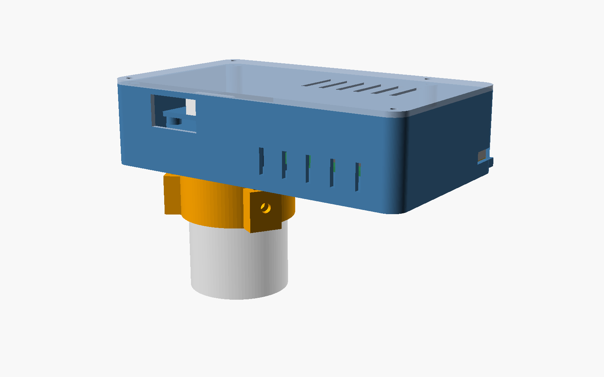
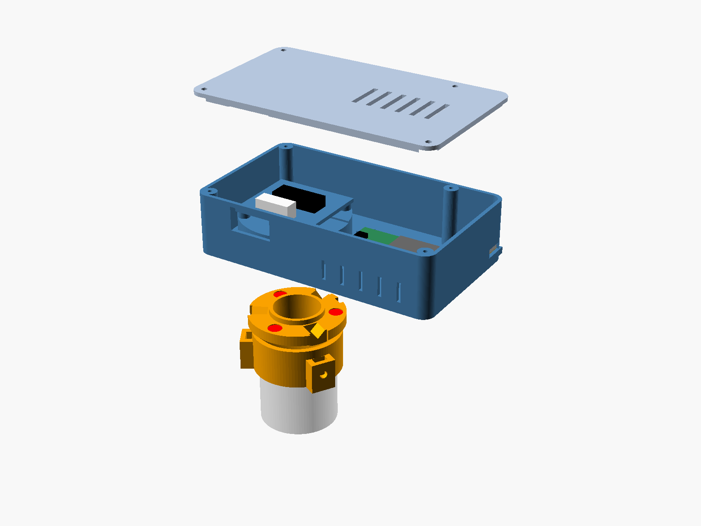
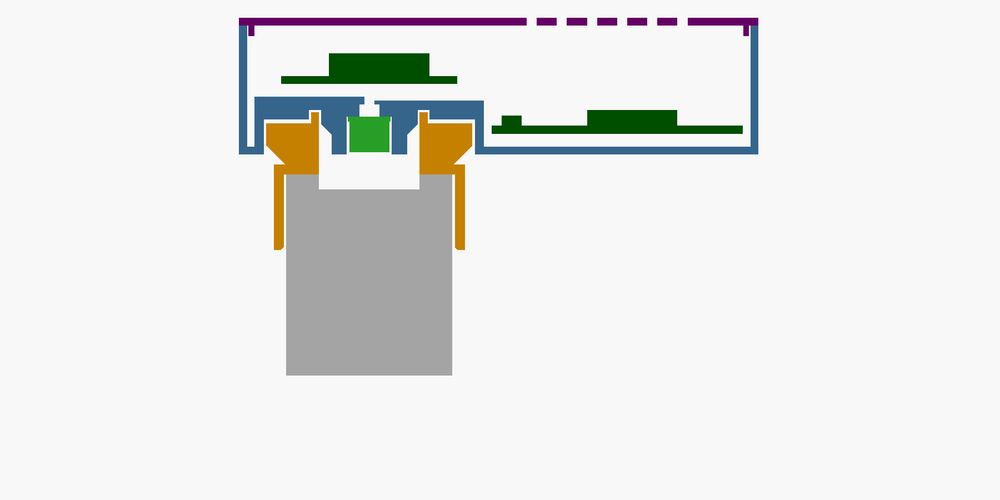

# Camera module and eyepiece rings (OV5640 behind the eyepiece)

Parametric OpenSCAD model: `camera_cap.scad`. Design and reasoning: `plans/camera-module/`. One
camera module (ESP32-S3 CAM, OV5640, the focus motor's ULN2003 driver, USB-C and motor sockets) snaps
magnetically onto a ring that stays on each eyepiece. The ring is a kinematic seat (three steel balls in
three V-grooves), so the module goes back in the same place every time, and
the ring's height carries that eyepiece's eye relief, so the module is the same for all three eyepieces.

Printed parts:

- **ring**: one per eyepiece (25 / 12.5 / 8 mm). A sleeve slides over the eyepiece housing and is
  centred and held by three radial M3 thumbscrews at 120 degrees. A tube leads up to the seat plate:
  three radial 90 degree V-grooves (balls), three magnet pockets, a key notch (so the module always sits
  the same way round), and a light lip. Eyepiece swap = lift the module off, put it on the next ring.
- **module_base**: the island on the underside (three ball pockets, three magnet pockets, a skirt that wraps
  the ring's seat plate, a key tab, and the OV5640 nose that reaches down into the ring's tube), the tray
  for the ESP32-S3 CAM board and the USB-C breakout, four posts for the ULN2003 board above the island, a
  window for USB-C and a window for the motor plug.
- **module_lid**: closes the tray with four M2 screws, vent slots over the ESP32.

The light path is closed: the nose sits inside the ring's tube, a lip on the ring enters a groove in the
module's roof, a flange on the nose sits inside the lip, and the skirt wraps the plate edge. The air gap
between ring and module is the same 0.8 mm everywhere (`seat_gap`).

Assumptions to check: defaults come from the design (National Geographic 76/700, 25 / 12.5 / 8 mm
eyepieces, always with the 3x Barlow). No published eye relief exists for these eyepieces, so the values
are estimates; measure them. The boards' sizes are typical, measure yours.

## Parts you need

| Part | Qty | Notes |
|---|---|---|
| Neodymium disc magnets N52 6 x 3 mm (`mag_d`, `mag_t`) | 3 per ring + 3 for the module (12 for three rings) | pair of 3 pulls about 1 kgf at contact, and holds the module upside down with a large margin |
| Steel (bearing) balls 5 mm, grade 100 or better (`ball_d`) | 3 | the V-groove seat needs round, hard balls; no plastic or glass |
| ULN2003 driver board with 4 x M3 holes, about 35 x 32 mm | 1 | usually sold with the 28BYJ-48; `uln`, `uln_holes` |
| 28BYJ-48 (5 V, unipolar) | 1 | the focus motor, `hardware/focus-mount/`; plugs into the ULN board |
| USB-C breakout (panel type, 16 pin or 6 pin, about 16 x 11 mm) | 1 | the Robin link cable plugs in here (serial + 5 V, not USB) |
| JST-XH 5-pin header (2.5 mm) | 0 or 1 | only for `motor_port = "jst"`; default plugs the motor straight into the ULN board's own socket |
| OV5640 24-pin module with FPC, ESP32-S3 CAM board | 1 each | measure them (below) |
| M3 x 16 thumbscrews + M3 nuts | 3 per ring | knurled head |
| M3 x 6 self-tapping or pan head screws | 4 | ULN board on its posts |
| M2 x 8 screws | 4 | lid (they cut their own thread in the PETG posts) |
| Thin cyanoacrylate or epoxy, hot glue or double sided foam tape, black flocking paper, PETG filament | | |

## What to measure

Use calipers. Edit the values at the top of `camera_cap.scad`, or override on the command line, for
example `-D housing_od=32.6`.

1. **Per eyepiece** (row of `eyepiece_table`: `[eyepiece mm, housing OD, eye relief with Barlow, rim
   recess]`):
   - **housing_od**: outer diameter of the housing over the top 15 mm, three places, take the largest.
   - **rim_id**: opening at the rim (the nose must fit when `gap` is small). Default 20.
   - **lens_recess**: how far the eye lens sits below the rim (straight edge across the rim, depth rod).
   - **eye_relief** with the Barlow in place, by the paper method:
     1. Put the Barlow and the eyepiece in the focuser as you normally use them.
     2. Point the telescope at a bright, distant, daylight scene (a window with sky, a bright wall far
        away, an indoor lamp). **Never point it at the Sun, not even briefly: the telescope focuses
        sunlight into a burn spot and a blinding beam.** Cover the Sun's direction and keep the
        telescope far from it.
     3. Hold a sheet of white paper behind the eyepiece and move it away from the eye lens until the
        bright disc on the paper is smallest and sharpest. That disc is the exit pupil.
     4. Measure from the eye lens glass (not the rim) to the paper. Repeat three times, take the mean.
2. **OV5640 module**: PCB width and thickness, lens holder width, lens front to PCB front face
   (`module_h`), FPC width and **FPC length** (`fpc_len`; the model checks that the ribbon reaches the
   ESP32 socket, about 33 mm).
3. **ESP32-S3 CAM board**: `esp_w` x `esp_l`, thickness, tallest part above the board (`esp_comp_h`),
   the camera socket's distance from the board end (`esp_sock_end`). The board sits with the socket end
   facing the island; flip the model (or mirror the part) if your socket is at the other end.
4. **ULN2003 board**: size, M3 hole spacing, tallest part including a mated plug (`uln_comp_h`), and where
   the motor socket sits along the edge (`uln_sock_x`). The socket edge faces the -y wall, where the window
   is. If your board's socket points sideways, the plug goes in through the window; if it points up, plug
   the motor in before closing the lid and let the cable leave through the window.
5. **USB-C breakout**: board size and thickness, receptacle shell size (`usb_pcb`, `usb_shell`).
6. **Balls and magnets**: measure the real diameters; the pockets have 0.2 mm (balls) and 0.15 mm
   (magnets) of clearance.

## The gap formula and the ring height

`gap` is the distance from the eyepiece rim to the front of the camera lens:

    gap = eye_relief - lens_recess - lens_stop_offset

`lens_stop_offset` (default 1.5) is how far the camera's aperture stop sits behind the front glass.
The ring's seat plane is then placed so that the module's lens ends up exactly there:

    z_seat = rim + gap - lens_in + nose_out - seat_gap       (+ seat_trim)

Defaults with the Barlow (the console prints these when you render):

| eyepiece | eye_relief | lens_recess | lens_stop_offset | gap | seat plane above the sleeve end |
|----------|-----------:|------------:|-----------------:|----:|-------:|
| 25 mm    | 18         | 3           | 1.5              | 13.5 | 34.2 mm |
| 12.5 mm  | 9          | 3           | 1.5              | 4.5 | 25.2 mm |
| 8 mm     | 5          | 3           | 1.5              | 0.5 | 21.2 mm |

If a combination is impossible (nose would touch the eye lens, nose does not fit the rim opening, the
groove would break through to the rim, ball or magnet geometry that does not fit, boards that do not fit
the box) OpenSCAD stops with an `assert` message that names the parameter to change. After the first test
you can nudge one ring's height with `seat_trim` (mm, lens up is positive) without touching the others.

## Export STLs

With `openscad` (Windows: `"C:/Program Files/OpenSCAD/openscad.com"`) in this folder. STLs are build
output and are not committed.

    openscad -o ring_25.stl   -D 'part="ring"' -D eyepiece=25   camera_cap.scad
    openscad -o ring_12.5.stl -D 'part="ring"' -D eyepiece=12.5 camera_cap.scad
    openscad -o ring_8.stl    -D 'part="ring"' -D eyepiece=8    camera_cap.scad
    openscad -o base.stl      -D 'part="module_base"' camera_cap.scad
    openscad -o lid.stl       -D 'part="module_lid"'  camera_cap.scad

Pictures: `part="assembly"` or `"exploded"` (add `-D show_lid=false` to look into the box); `-D
section=true` gives a flat colour cross-section (`-D 'section_plane="x"'` for the plane through a ball
and a magnet pair). `part="clash"` is a developer check: it must render empty (nothing of the module
touches the ring; `-D clash_dz=-0.1` lowers the module by 0.1 mm and must then report a clash). The motor window variants are `-D 'motor_port="jst"'`.

## Print settings

- PETG, 0.2 mm layers, 0.4 mm nozzle, 4 perimeters, 20-30 % infill, no supports needed. Black or dark
  matt PETG if you can: the inside of the nose and the ring's tube must not reflect.
- **ring**: print as exported, open sleeve end on the bed, axis vertical. The cone under the seat plate is
  45 degrees, grooves and pockets open upward, the nut slots open at the top. Drop the nuts in before
  fitting the thumbscrews.
- **module_base**: print as exported (`print_pose = true`): the nose end and the bottom edges of the walls
  and skirt on the bed, the box opening upward. The island roof is a bridge of about 11 mm between the nose
  flange and the skirt (slow it down, fan on); the ball and magnet pockets are 5-6 mm bridges, the key tab
  and flange have 45 degree undersides. If the roof sags, add a temporary support ring under it.
- **module_lid**: print as exported (`print_pose = true`): plate on the bed, lip pointing up.
- Ream the 3.4 mm screw holes if the first layers squish them; the M2 and M3 holes are self-tapping pilots.

## Magnets: polarity rule, mark them

All three **ring** magnets have the **same pole up**; all three **module** magnets have the **opposite
pole down**, so every pair attracts. Mark them so you cannot mix them up:

1. Stack the magnets and push one off the stack at a time; the face that stays on the same side of each
   one is the same pole. Put a dot of permanent marker on that face of every magnet.
2. **Ring**: glue the magnets with the **dotted face up**.
3. **Module**: glue the magnets with the **dotted face towards the inside of the box** (the undotted face
   looks at the ring).
4. Before the glue sets, hold a module magnet over its ring magnet: it must be pulled in. If it pushes
   away, that magnet is the wrong way round; flip it.

Magnets press into their pockets until they hit the pocket ceiling (module) or floor (ring); they end
0.3 mm below the surface. Ring pockets open upward; module pockets open downward, so hold the base
upside down to glue them.

## Gluing the balls

1. Press each ball into its pocket from below until it touches the ceiling (that sets the height; the
   pocket holds only the top 2 mm of the ball, so use epoxy or a good CA gel, not a drop of thin glue).
   Do not glue the ball into the groove.
2. Put the base on a flat glass plate or a mirror. All three balls must touch it and the module must not
   rock. Measure with calipers: the balls stand 3 mm below the underside plane (`ball_protrusion`).
3. Clean the balls with alcohol before the first fit. A thin film of light oil in the V-grooves keeps
   them quiet.

## Assembly and centring each ring once

1. Press the three M3 nuts into the slots at the top of the ring bosses, run the thumbscrews in.
2. Glue the ring magnets (polarity rule above). Line the inside of the tube with black flocking paper
   if the print is shiny.
3. In the module: press the OV5640 into the nose pocket from the nose end, lens facing out, the FPC up
   through the slot and along the groove on the island top toward the ESP32; a dab of hot glue or
   black tape holds it. Fit the ULN2003 board on its four posts (M3 screws), the ESP32 board on its corner
   pads (foam tape or hot glue), the USB-C breakout against the +x end wall behind its window. Wire the
   ULN2003 inputs to the ESP32 pins chosen in the bridge slice, 5 V and GND from the USB-C breakout (see
   [docs/wiring.md](../../docs/wiring.md)), plug the FPC in.
4. Put the ring on the eyepiece (eyepiece in the focuser, Barlow in place) until its rim shoulder touches
   the top of the eyepiece. Run the three thumbscrews in until they just touch the housing.
5. **Centre, once per ring**: snap the module on, connect the camera, open the live view on a distant
   target. Tighten the three thumbscrews a little at a time, one then the next, until the circular field
   is centred in the image (the circle of the eyepiece field stop must not be clipped; the optical centre
   is the image centre). Do not over-tighten; the screws only need to grip. Then **leave the ring on
   the eyepiece**: it stays centred, and the module can be lifted off and put back on any ring.
6. Check the height: the field must be sharp and evenly lit with no dark corners (focus with the
   telescope's focuser). If the lens is a little too high or low, change `seat_trim` for that ring and
   reprint just that ring.
7. Close the lid (four M2 screws). Label the USB-C breakout "OAE LINK, NOT USB".

The module is 103 x 60 x 27 mm (lid on, nose and skirt included; the console prints it). Weight target under 80 g with magnets. The two printed parts are 41 cm3 of PETG (52 g if printed solid,
about 40 g with 4 perimeters and 20 % infill); with the ESP32 board (10 g), ULN2003 board (8 g), USB-C
breakout, camera, magnets, balls and screws (about 12 g) the module weighs about 70 g, and 80 g at worst. The
focus motor is on the focuser, not on the module. To save weight, reduce `box_wall`, `lid_t` and `low_t`
only down to the perimeter width multiple you print with.

## Safety

The USB-C socket on the module is the Robin link: it carries the serial port and 5 V, **not USB**. Never
plug a computer, phone, charger or power bank into it, and never plug the link cable into the ESP32's own
USB-C port. Read the "Robin to ESP32 cable: not USB" section of the [project README](../../README.md)
before wiring it. To flash the ESP32 over its own port, open the lid and unplug the link cable first.
The paper-method eye relief measurement above needs a telescope: never aim it at the Sun.
