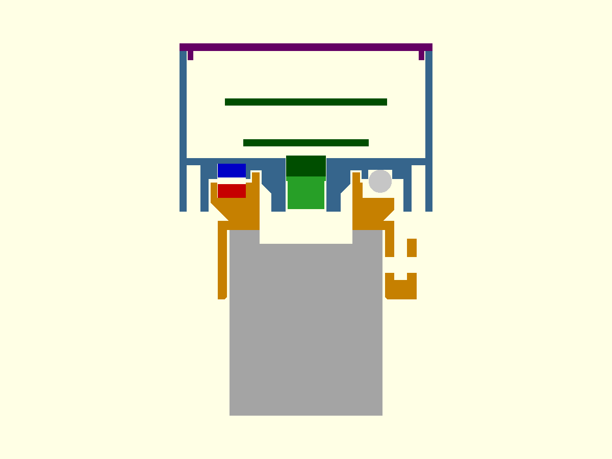

# Camera module and eyepiece rings (OV5640 behind the eyepiece)

Parametric OpenSCAD model: `camera_cap.scad`. Design and reasoning: `plans/archive/camera-module/`. One
compact camera module (ESP32-S3 CAM, OV5640, the focus motor's ULN2003 driver, a Mini-360 buck converter that
makes the module's 5.1 V from 15 V on the cable, USB-C and motor sockets),
centred on the optical axis, snaps magnetically onto a ring that stays on each eyepiece. The ring is a kinematic seat (three steel balls in
three V-grooves), so the module goes back in the same place every time, and
the ring's height carries that eyepiece's eye relief, so the module is the same for all three eyepieces.

Printed parts:

- **ring**: one per eyepiece (25 / 12.5 / 8 mm). A sleeve slides over the eyepiece housing and is
  centred and held by three radial M3 thumbscrews at 120 degrees. A tube leads up to the seat plate:
  three radial 90 degree V-grooves (balls), three magnet pockets, a key notch (so the module always sits
  the same way round), and a light lip. Eyepiece swap = lift the module off, put it on the next ring.
- **module_base**: a box 60 x 55 mm centred on the eyepiece. Underneath, the island: three ball pockets, three
  magnet pockets, a skirt that wraps the ring's seat plate, a key tab, and the OV5640 nose that reaches down
  into the ring's tube. Above it the boards are stacked (see Layout); posts for the ULN2003 board, a seat
  for the USB-C breakout, a cradle for the JST-XH motor header, a window each in the end wall, and a seat for
  the Mini-360 with a cradle for its output capacitor.
- **module_lid**: closes the box with four M2 screws, vent slots over the boards.

## Layout (compact, centred)

Everything hangs on the optical axis, so the module's weight does not pull sideways on the magnets, the
eyepiece or the focuser: about 51 g in a box of 60 x 55.2 x 36 mm (the nose and skirt, 7 mm, included), centre
of mass 2.9 mm from the axis and 8.8 mm above the seat plane (the console prints both; `com_limit` = 5 mm is
asserted). The footprint is set by two things: the island that carries the ring interface is 46 mm round
(the same as before), and the ESP32 board (50 x 27 mm) is shifted 6 mm toward the ports so the ribbon is short.

From the nose upward (u is the height above the seat plane):

1. **OV5640**, lens at the nose end, PCB at u = 0.5 mm, in a square pocket on the axis.
2. **Island floor**, 4.5 mm (the ball and magnet pockets are in it). The ribbon leaves the camera straight
   up through a slot, bends along the floor toward the end away from the ports, rises past the end of the
   ESP32 and folds back over it to the camera socket (three folds, 37.5 mm of ribbon, the model asserts that
   your `fpc_len` covers it plus 2 mm).
3. **ESP32-S3 CAM**, component side up, 2.5 mm above the floor on four corner pads, two stops at the ribbon end;
   the wall stops the other end, and the driver posts stop its long edges. Boards with mounting holes: list
   them in `esp_holes` and it gets M2 posts instead.
4. **ULN2003 driver** on four 11 mm posts (M3 self-tapping screws) over the ESP32's tallest part, turned 90
   degrees (its 35 mm side runs across the box). The posts at the ESP32's long edges are cropped to 0.25 mm off the
   board. `driver = "dip"` swaps the common 35 x 32 board for a bare ULN2003A on a 34 x 20 perfboard with the
   same post positions: 3 mm lower and 5 g lighter, no footprint gain, so `"board"` is the default.
5. **Mini-360 buck converter** (power, see below) lies flat in the strip beside the ESP32 on the motor side, behind the
   wall vents, away from the camera ribbon; the driver board sits over half of it. Its 100 uF output capacitor lies
   next to it, in a cradle against the wall (this makes the box 0.6 mm wider). The 10 uF ceramic needs no
   pocket: solder it across the output pads, there is free air above the board.
6. **Lid** with vent slots. The vents sit above the island (the ESP32 and driver), never over the optical path.

**Ports** share one end wall (`port_side = "+x"` or `"-x"`; point it away from the focus motor, the key fixes
which way round the module sits on the ring and you can turn the ring on the eyepiece). The USB-C breakout is in
one y strip beside the ESP32 (`usb_side`), the JST-XH motor header stands on its edge in the cradle in the other
strip. The 28BYJ-48 plugs into that header; a short pigtail runs from it to the driver (below).

**Power.** The Robin does not power the module. The USB-C cable carries **15 V** on VBUS (from the fused PD-trigger
output); the Mini-360 (MP2307 type, 17 x 11 x 4 mm, input up to about 23 V, set to **5.1 V**) turns it into 5.1 V for the
ESP32-S3 CAM and the ULN2003 + 28BYJ-48: about 0.75 A at 5 V, about 0.3 A at 15 V in the cable. Wiring and the
power budget are in [docs/wiring.md](../../docs/wiring.md). There is no access hole to the trim pot (the driver board sits over half
of the Mini-360): set the voltage on the bench before building the board in.

The light path is closed: the nose sits inside the ring's tube, a lip on the ring enters a groove in the
module's roof, a flange on the nose sits inside the lip, and the skirt wraps the plate edge. The air gap
between ring and module is the same 0.8 mm everywhere (`seat_gap`).

Assumptions to check: defaults come from the design (National Geographic 76/700, 25 / 12.5 / 8 mm
eyepieces, always with the 3x Barlow). No published eye relief exists for these eyepieces, so the values
are estimates; measure them. The boards' sizes are typical, measure yours.

## Parts you need

| Part | Qty | Notes |
|---|---|---|
| Neodymium disc magnets N52 6 x 3 mm (`mag_d`, `mag_t`) | 3 per ring + 3 for the module (12 for three rings) | pair of 3 pulls about 1 kgf at contact, and holds the module upside down with a large margin |
| Steel (bearing) balls 5 mm, grade 100 or better (`ball_d`) | 3 | the V-groove seat needs round, hard balls; no plastic or glass |
| ULN2003 driver board with 4 x M3 holes, about 35 x 32 mm | 1 | usually sold with the 28BYJ-48; `uln`, `uln_holes` (or a bare ULN2003A DIP-16 + perfboard for `driver = "dip"`) |
| 28BYJ-48 (5 V, unipolar) | 1 | the focus motor, `hardware/focus-mount/`; plugs into the JST-XH header in the module's wall |
| USB-C breakout (panel type, 16 pin or 6 pin, about 16 x 11 mm) | 1 | the Robin link cable plugs in here (serial + 15 V, not USB); a GX12 4-pin or JST-SM connector is the safer alternative, see the project README |
| Mini-360 buck converter (MP2307 type, about 17 x 11 x 4 mm, input up to 23 V) | 1 | 15 V in, 5.1 V out for the ESP32 and the driver; `mini_pcb`, `mini_h` (measure yours: the trim pot and the pad layout differ between batches) |
| 100 uF electrolytic, 16 V or more, 8 x 12 mm (`cap_d`, `cap_l`) | 1 | output filter; lies in its cradle next to the Mini-360 |
| 10 uF ceramic, 10 V or more (1206 SMD or 5 mm radial) | 1 | output filter, across the Mini-360 output pads |
| 22 AWG wire, thin silicone wire (26 to 28 AWG) | | 22 AWG for the 15 V tap at the Robin end; thin wire inside the module |
| JST-XH 5-pin male header, side entry (2.5 mm, e.g. S5B-XH-A) | 1 | the motor socket in the wall; its five pins are wired to the driver's motor header (a 5-pin XH female pigtail plugged into the ULN board's own socket is the easy way; with `driver = "dip"` solder to the perfboard) |
| OV5640 24-pin module with FPC, ESP32-S3 CAM board | 1 each | measure them (below) |
| M3 x 16 thumbscrews + M3 nuts | 3 per ring | knurled head |
| M3 x 6 self-tapping or pan head screws | 4 | driver board on its posts |
| M2 x 8 screws | 4 | lid (they cut their own thread in the PETG posts) |
| Thin cyanoacrylate or epoxy, hot glue or double sided foam tape, black flocking paper, PETG filament | | |

## What to measure

Use calipers. Edit the values at the top of `camera_cap.scad`, or override on the command line, for
example `-D housing_od=32.6`.

1. **Per eyepiece** (row of `eyepiece_table`: `[eyepiece mm, housing OD, eye relief with Barlow, rim
   recess]`):
   - **housing_od**: outer diameter of the housing over the top 15 mm, three places, take the largest.
   - **rim_id**: opening at the rim (the nose must fit when `gap` is small). Default 20.
   - **lens_recess**: how far the eye lens sits below the rim (straight edge across the rim, depth rod).
   - **eye_relief** with the Barlow in place, by the paper method:
     1. Put the Barlow and the eyepiece in the focuser as you normally use them.
     2. Point the telescope at a bright, distant, daylight scene (a window with sky, a bright wall far
        away, an indoor lamp). **Never point it at the Sun, not even briefly: the telescope focuses
        sunlight into a burn spot and a blinding beam.** Cover the Sun's direction and keep the
        telescope far from it.
     3. Hold a sheet of white paper behind the eyepiece and move it away from the eye lens until the
        bright disc on the paper is smallest and sharpest. That disc is the exit pupil.
     4. Measure from the eye lens glass (not the rim) to the paper. Repeat three times, take the mean.
2. **OV5640 module**: PCB width and thickness, lens holder width, lens front to PCB front face
   (`module_h`), FPC width and **FPC length** (`fpc_len`). The ribbon now goes up, along the floor, up past
   the ESP32's end and back over it to the socket: about 37.5 mm with the default layout, and the model
   asserts `fpc_len` >= that + 2 mm. A 40 mm ribbon just fits, anything shorter does not (raise `esp_dx`, which
   moves the ESP32 toward the ports, or buy a longer ribbon; ribbons of 45 to 60 mm are sold).
3. **ESP32-S3 CAM board**: `esp_w` x `esp_l`, thickness, tallest part above the board (`esp_comp_h`),
   the camera socket's distance from the board end (`esp_sock_end`), mounting holes if any (`esp_holes`).
   The board lies component side up with the camera socket at the end away from the ports; if your socket is
   at the other end, use `port_side` on the other side.
4. **Mini-360**: board size (`mini_pcb`), height of the tallest part (`mini_h`), and the four corner pads
   (`mini_pad` keeps the rails clear of them). The model puts the OUT end toward the capacitor; the board must sit with
   IN toward the ribbon end of the box.
5. **ULN2003 board**: size, M3 hole spacing, tallest part (`uln_comp_h`). Its holes must be a little more
   than the ESP32 width apart across the box (30 mm for 27 mm: the model asserts it). Its own motor socket is
   not used through the wall: plug the pigtail from the wall header into it.
6. **USB-C breakout**: board size and thickness, receptacle shell size (`usb_pcb`, `usb_shell`). The
   breakout must fit the strip beside the ESP32 (its width sets the box width).
7. **Balls and magnets**: measure the real diameters; the pockets have 0.2 mm (balls) and 0.15 mm
   (magnets) of clearance.

## The gap formula and the ring height

`gap` is the distance from the eyepiece rim to the front of the camera lens:

    gap = eye_relief - lens_recess - lens_stop_offset

`lens_stop_offset` (default 1.5) is how far the camera's aperture stop sits behind the front glass.
The ring's seat plane is then placed so that the module's lens ends up exactly there:

    z_seat = rim + gap - lens_in + nose_out - seat_gap       (+ seat_trim)

Defaults with the Barlow (the console prints these when you render):

| eyepiece | eye_relief | lens_recess | lens_stop_offset | gap | seat plane above the sleeve end |
|----------|-----------:|------------:|-----------------:|----:|-------:|
| 25 mm    | 18         | 3           | 1.5              | 13.5 | 34.2 mm |
| 12.5 mm  | 9          | 3           | 1.5              | 4.5 | 25.2 mm |
| 8 mm     | 5          | 3           | 1.5              | 0.5 | 21.2 mm |

If a combination is impossible (nose would touch the eye lens, nose does not fit the rim opening, the
groove would break through to the rim, ball or magnet geometry that does not fit, boards that do not fit
the box) OpenSCAD stops with an `assert` message that names the parameter to change. After the first test
you can nudge one ring's height with `seat_trim` (mm, lens up is positive) without touching the others.

## Export STLs

With `openscad` (Windows: `"C:/Program Files/OpenSCAD/openscad.com"`) in this folder. STLs are build
output and are not committed.

    openscad -o ring_25.stl   -D 'part="ring"' -D eyepiece=25   camera_cap.scad
    openscad -o ring_12.5.stl -D 'part="ring"' -D eyepiece=12.5 camera_cap.scad
    openscad -o ring_8.stl    -D 'part="ring"' -D eyepiece=8    camera_cap.scad
    openscad -o base.stl      -D 'part="module_base"' camera_cap.scad
    openscad -o lid.stl       -D 'part="module_lid"'  camera_cap.scad

Pictures: `part="assembly"` or `"exploded"` (add `-D show_lid=false` to look into the box); `-D
section=true` gives a flat colour cross-section (`-D 'section_plane="x"'` for the plane through a ball
and a magnet pair). `part="clash"` is a developer check: it must render empty (nothing of the module
touches the ring; `-D clash_dz=-0.1` lowers the module by 0.1 mm and must then report a clash). `part="clash_in"`
checks the boards, header and ribbon against the base and lid (only resting contacts remain). Layout
variants: `-D 'driver="dip"'`, `-D 'port_side="-x"'`, `-D usb_side=-1`.

## Print settings

- PETG, 0.2 mm layers, 0.4 mm nozzle, 4 perimeters, 20-30 % infill, no supports needed. Black or dark
  matt PETG if you can: the inside of the nose and the ring's tube must not reflect.
- **ring**: print as exported, open sleeve end on the bed, axis vertical. The cone under the seat plate is
  45 degrees, grooves and pockets open upward, the nut slots open at the top. Drop the nuts in before
  fitting the thumbscrews.
- **module_base**: print as exported (`print_pose = true`): the nose end and the bottom edges of the walls
  and skirt on the bed, the box opening upward, no supports. The island roof is a bridge of about 11 mm between the nose
  flange and the skirt (slow it down, fan on); the 1.6 mm floor around the island bridges 2 to 16 mm between the skirt
  and the walls; the ball and magnet pockets are 5-6 mm bridges, the key tab and flange have 45 degree
  undersides. The posts, pads and the motor cradle all stand on that floor. If the roof sags, add a temporary
  support ring under it.
- **module_lid**: print as exported (`print_pose = true`): plate on the bed, lip pointing up.
- Ream the 3.4 mm screw holes if the first layers squish them; the M2 and M3 holes are self-tapping pilots.

## Magnets: polarity rule, mark them

All three **ring** magnets have the **same pole up**; all three **module** magnets have the **opposite
pole down**, so every pair attracts. Mark them so you cannot mix them up:

1. Stack the magnets and push one off the stack at a time; the face that stays on the same side of each
   one is the same pole. Put a dot of permanent marker on that face of every magnet.
2. **Ring**: glue the magnets with the **dotted face up**.
3. **Module**: glue the magnets with the **dotted face towards the inside of the box** (the undotted face
   looks at the ring).
4. Before the glue sets, hold a module magnet over its ring magnet: it must be pulled in. If it pushes
   away, that magnet is the wrong way round; flip it.

Magnets press into their pockets until they hit the pocket ceiling (module) or floor (ring); they end
0.3 mm below the surface. Ring pockets open upward; module pockets open downward, so hold the base
upside down to glue them.

## Gluing the balls

1. Press each ball into its pocket from below until it touches the ceiling (that sets the height; the
   pocket holds only the top 2 mm of the ball, so use epoxy or a good CA gel, not a drop of thin glue).
   Do not glue the ball into the groove.
2. Put the base on a flat glass plate or a mirror. All three balls must touch it and the module must not
   rock. Measure with calipers: the balls stand 3 mm below the underside plane (`ball_protrusion`).
3. Clean the balls with alcohol before the first fit. A thin film of light oil in the V-grooves keeps
   them quiet.

## Assembly and centring each ring once

1. Press the three M3 nuts into the slots at the top of the ring bosses, run the thumbscrews in.
2. Glue the ring magnets (polarity rule above). Line the inside of the tube with black flocking paper
   if the print is shiny.
3. **Set the Mini-360 to 5.1 V first, on the bench, before it goes near the ESP32.** Power the bare Mini-360 from the 15 V
   with nothing on its output but a meter, turn the trim pot until the meter reads 5.10 V (5.0 to 5.2 V is fine), then seal the pot
   with nail varnish or hot glue. Its factory setting can be anywhere up to the input voltage and would destroy the ESP32.
   Solder the 100 uF capacitor (observe polarity) and the 10 uF ceramic across its OUT+ / OUT- pads.
4. In the module, from the bottom up: press the OV5640 into the nose pocket from the nose end, lens facing
   out, the ribbon up through the slot (a dab of hot glue or black tape holds the camera). Lay the ribbon
   along the floor toward the end away from the ports and up past the ESP32's end. Drop the USB-C breakout
   into its seat in the strip (receptacle at the window, a drop of hot glue) and the JST-XH header into the
   cradle in the other strip (it stands on its edge, opening at the window, pins toward the box). Glue the Mini-360 on its
   rails (OUT end toward the capacitor, the capacitor in its cradle against the wall). Set the
   ESP32 on its pads (a dab of glue; or on M2 screws if you listed `esp_holes`), fold the ribbon back over it
   and plug it into the socket. Screw the ULN2003 board on its four posts (M3, screws from above). Wire the
   ULN2003 inputs to the ESP32 pins chosen in the bridge slice. Wire the USB-C breakout's VBUS to Mini-360 IN+
   and GND to IN- (the wires run under the ESP32 board, in its 2.5 mm stand-off space, to the strip on the other side); from
   the Mini-360 OUT+ / OUT- (5.1 V) feed the ESP32's 5V / GND pins and the ULN2003's + / -, and wire the
   header's five pins to the driver's motor socket through the pigtail (see
   [docs/wiring.md](../../docs/wiring.md)). Check 5.1 V at the ESP32's 5V pin with a meter before plugging in the cable for good.
5. Put the ring on the eyepiece (eyepiece in the focuser, Barlow in place) until its rim shoulder touches
   the top of the eyepiece. Run the three thumbscrews in until they just touch the housing.
6. **Centre, once per ring**: snap the module on, connect the camera, open the live view on a distant
   target. Tighten the three thumbscrews a little at a time, one then the next, until the circular field
   is centred in the image (the circle of the eyepiece field stop must not be clipped; the optical centre
   is the image centre). Do not over-tighten; the screws only need to grip. Then **leave the ring on
   the eyepiece**: it stays centred, and the module can be lifted off and put back on any ring.
7. Check the height: the field must be sharp and evenly lit with no dark corners (focus with the
   telescope's focuser). If the lens is a little too high or low, change `seat_trim` for that ring and
   reprint just that ring.
8. Close the lid (four M2 screws). Label the USB-C breakout "15 V - NOT USB".

The module is 60 x 55.2 x 36 mm (lid on, nose and skirt included; the console prints it). The printed parts are
about 34 cm3 of PETG, 17 g at the 40 % effective fill the model assumes (4 perimeters, 20 % infill, PETG at
1.27 g/cm3); with the ESP32 board (10 g), ULN2003 board (8 g), Mini-360 (2 g), capacitors (2 g), USB-C breakout, camera, header,
magnets, balls and screws (about 12 g) the module weighs about 51 g, 64 g at worst (the console prints the estimate and the
centre of mass offset, 2.9 mm; it stops if that exceeds 5 mm). The focus motor is on the focuser, not on the module.
The box is 36 mm tall, taller than the old side-by-side layout, so keep the focuser clear when it points
sideways. To save weight, reduce `box_wall`, `lid_t` and `low_t` only down to the perimeter width multiple
you print with.

## Safety

The USB-C socket on the module is the Robin link: it carries the serial port and **15 V** on VBUS, **not USB**. Never
plug a computer, phone, charger or power bank into it (15 V can destroy them), and never plug the link cable into the
ESP32's own USB-C port. Label both ends "15 V - NOT USB"; a non-USB connector (GX12 4-pin, JST-SM) is the safer choice. Read the "Robin to ESP32 cable: not USB" section of the [project README](../../README.md)
before wiring it. To flash the ESP32 over its own port, open the lid and unplug the link cable first.
The paper-method eye relief measurement above needs a telescope: never aim it at the Sun.
