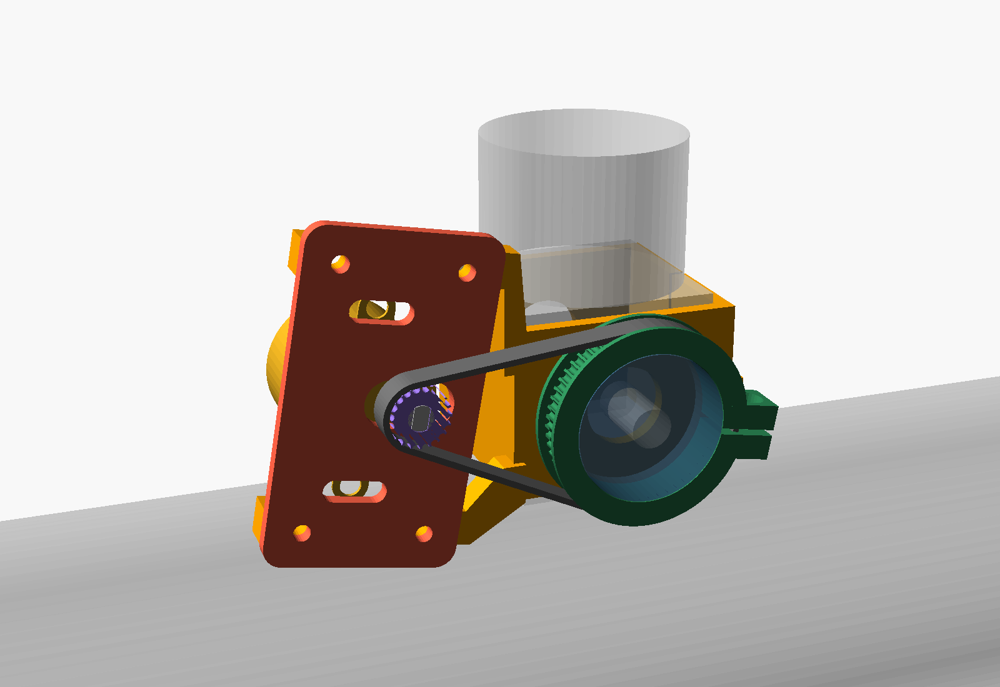

# Focus motor mount (28BYJ-48, GT2 belt)

Parametric OpenSCAD model: `focus_mount.scad`. A stock 28BYJ-48 (5 V, unipolar) turns the focus knob
of a cheap rack-and-pinion focuser through a 3:1 GT2 belt (6 mm, 20T motor pulley, 60T knob pulley). The
motor sits beside the knob on the side away from the focuser (towards the front of the tube, tilted
slightly up), so it stays clear of the eyepiece, Barlow and camera module above the drawtube.

The grey stand-ins (focuser block, drawtube, tube, knob, motor, belt) are for the picture only.

Four printed parts:

- **bracket**: rectangular split collar clamping the focuser body (M3 pinch screw at the back, on the
  -x side), two rails that carry the motor plate.
- **motor_plate**: flat plate bolted to the rails. The motor hangs behind it, its shaft and boss pass
  through a slot. Slots for both ear screws and the shaft give the belt tension (+-4 mm).
- **knob_pulley**: split ring with GT2 teeth and flanges, clamps the focus knob (M3 pinch screw).
- **motor_pulley**: GT2 pulley with a D bore for the double-flat shaft and an M3 grub screw.

The motor's own 5-pin JST-XH plug goes into the side-entry JST-XH socket on the camera module's end wall
(`../../hardware/camera-cap/`, design in `../../plans/archive/camera-module/design.md`); the module has its own
Mini-360 5.1 V supply, so there is no wiring on this part.

## Frames

World: the drawtube axis is z, z = 0 is the focuser body base (where it sits on the tube), x runs along
the tube, y along the knob axis. The motor is on the +y side (mirror the printed parts in the slicer for
the -y side). `motor_angle` (default 10 degrees) tilts the belt direction up from +x.

## What to measure

Use calipers; edit the values at the top of `focus_mount.scad` or override with `-D name=value`.

1. **body_x, body_y, body_h**: focuser body block: along the tube, across (the span between the sides the
   knobs are on), and height from the tube seat to the top face (defaults 40 / 40 / 40). The collar wall
   runs from `clamp_z0` (3) up to `body_h - 2`, so the body top must stay free for the drawtube.
2. **knob_d, knob_w**: focus knob diameter and width (30 / 12), at the thickest point.
3. **knob_axis_z, knob_axis_x**: knob shaft axis height above the tube seat (20) and its offset from the
   drawtube axis along the tube (0, `+x` = towards the motor side).
4. **knob_gap**: body side face to the inner face of the knob (4). The collar side wall (`collar_wall_y`,
   3) sits in this gap and the model asserts `knob_gap >= collar_wall_y + fit + 0.5` (3.8 with the defaults). Thinner gap: lower
   `collar_wall_y` (min about 2). `shaft_hole_d` (16) is the hole in the side walls around the shaft hub.
5. **drawtube_od** (42) and **tube_od** (76): ghosts only, but check the rail post on the +x face clears
   the drawtube in `assembly`.
6. **Motor**: confirm the 28BYJ-48 dimensions of your batch (body 28, ear holes 35 mm apart / 4.2, shaft 5
   with flats 3 across, shaft offset 8, shaft tip 10 mm beyond the ear face, flats about 6 mm long).

## Belt length

The console prints the belt to buy when you open or export the file, for example:

    BELT: needed pitch length 175.5 mm -> BUY a GT2 6 mm closed loop of 176 mm (88 teeth)
    BELT: centre distance for that loop = 46.24 mm (slot travel +-4 mm around it)

`motor_distance` (46) is the wanted centre distance; the loop is rounded up to the next common GT2 length
(100 to 200 mm, 2 mm steps) and the model uses the centre distance of that loop. With the defaults:
**GT2 6 mm closed loop, 176 mm**. The 3 mm of spare slot travel on either side takes up tolerances. Any
other pulley combination changes the number: edit `motor_teeth` / `knob_teeth` and read the echo again.

## What to buy

- GT2 closed-loop belt, 6 mm wide, **176 mm** (the echoed length for your parameters).
- bracket: 1x M3 x 16 + 1x M3 nut (pinch); 4x M3 x 10 + 4x M3 nut (plate to rails: screw heads on the belt
  side, nuts in the rail pockets).
- motor_plate: 2x M4 x 10 + 2x M4 nut (motor ears; M3 also works if the ear holes allow it).
- knob_pulley: 1x M3 x 14 + 1x M3 nut (pinch).
- motor_pulley: 1x M3 x 5 grub screw (or a short M3 cap screw).
- Optional: a strip of rubber or tape between knob and ring for grip.

## Print settings

PETG, 0.2 mm layers, 0.4 mm nozzle, 4 perimeters, 30 % infill (pulleys 100 %).
`-D print_pose=true` puts the bracket and plate in print orientation.

- **bracket**: outboard (+y) face down: the rails lie flat on the bed. **Supports needed** under the back
  wall (the -y wall bridges about 40 mm) and under the root posts; use tree supports or accept a
  slow, fan-on bridge. The M3 nut pockets open to the bed side.
- **motor_plate**: flat, belt side up.
- **knob_pulley, motor_pulley**: lying flat as modelled (axis vertical).

Fit tests: print the pulleys first. The GT2 grooves have `gt2_clr` (0.15) of clearance; the belt should sit
in the grooves without being forced. Increase `gt2_clr` if the teeth are too tight; set `knob_fit` to 0.0
for a snugger knob bore. Ream the 3.4 mm holes if they squish.

## Assembly and tensioning

1. Clamp: slide the pinch nut into its pocket, put the bracket on the focuser body from the +y side (the
   rails point to the knob side, towards +x), tighten the M3 pinch screw at the back until it does not
   rock. The bracket must not touch the knob or the focuser's moving parts.
2. Knob pulley: slip it over the knob (belt-side flange outermost, pinch ears on the -x side, opposite the
   motor), tighten the pinch screw with the knob free to turn.
3. Motor: put the motor plate on its back with the motor's ears on the inboard face, boss in the slot, and
   fit the two M4 screws with the nuts on the ear side (heads on the belt side), nuts finger tight.
4. Motor pulley: push it onto the shaft (D bore on the flats, 0.5 mm clear of the plate), tighten the grub
   screw on a flat.
5. Plate to bracket: M3 x 10 from the belt side through the plate and rail into the nuts; leave them loose.
6. Belt: loop it over the knob pulley, then the motor pulley. Pull the motor plate assembly along the
   slots away from the knob until the belt is snug (it should deflect about 2 mm under a light finger
   push, no slack, no humming under load), then tighten the two M4 screws and the four M3 screws.
7. Check by hand: the knob turns smoothly by turning the motor pulley, the belt stays between the flanges.

Do not over-tension: the 28BYJ-48 bearing is plain brass and tolerates only a light side load.

## Clearances to check in the assembly

- Motor plate and rails against the Barlow / camera module: the rails and plate stay at x >= about 22 mm
  and y >= 18 mm. The camera module (60 x 55 mm in plan, centred on the optical axis, not modelled here) covers
  that area seen from above, so check the height: rails and plate must stay below the module's underside
  (and its nose and skirt) with the eyepiece in place. Use `motor_angle` (-40 to 40) to move the motor down or up, and
  `motor_distance` to pull it away.
- The lower rail stays above the tube: with a 76 mm tube it is about 1 mm clear at the root; raise
  `motor_angle` or `knob_axis_z` if your tube is larger.
- Exported checks used here: the bracket does not intersect the focuser block, tube, drawtube, knob,
  motor, belt or pulleys; the motor plate touches the motor only on its face.

## Export

With `openscad` (Windows: `"C:/Program Files/OpenSCAD/openscad.com"`) in this folder. STLs are build
output and not committed.

    openscad -o bracket.stl      -D 'part="bracket"'      -D print_pose=true focus_mount.scad
    openscad -o motor_plate.stl  -D 'part="motor_plate"'  -D print_pose=true focus_mount.scad
    openscad -o knob_pulley.stl  -D 'part="knob_pulley"'  focus_mount.scad
    openscad -o motor_pulley.stl -D 'part="motor_pulley"' focus_mount.scad

Preview picture: `-D 'part="assembly"' --camera=25,20,35,70,0,160,330 --projection=p`.
